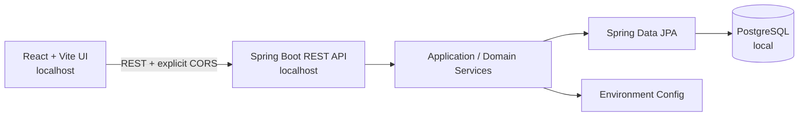
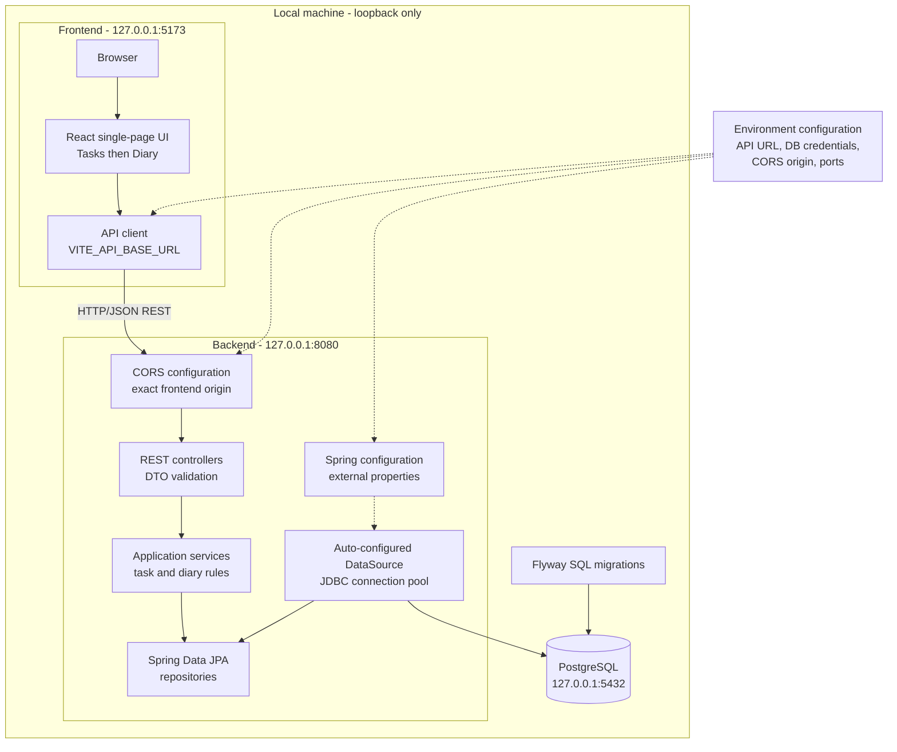
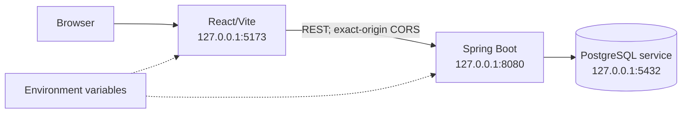
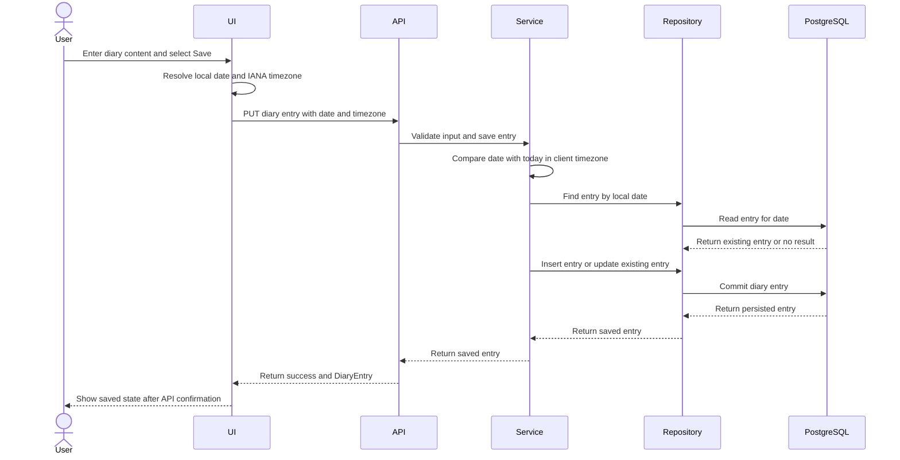
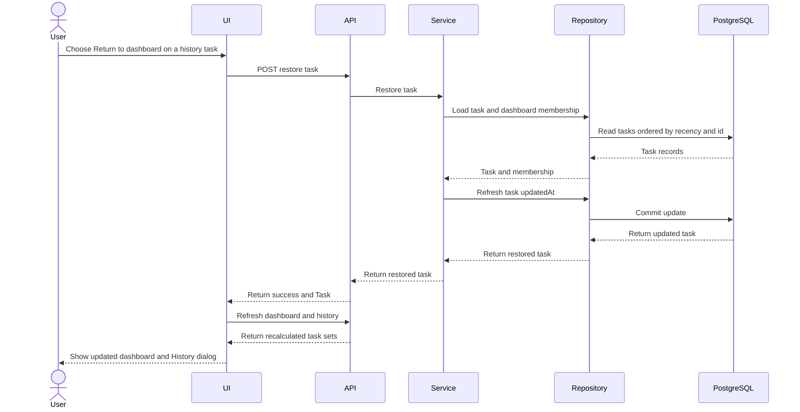
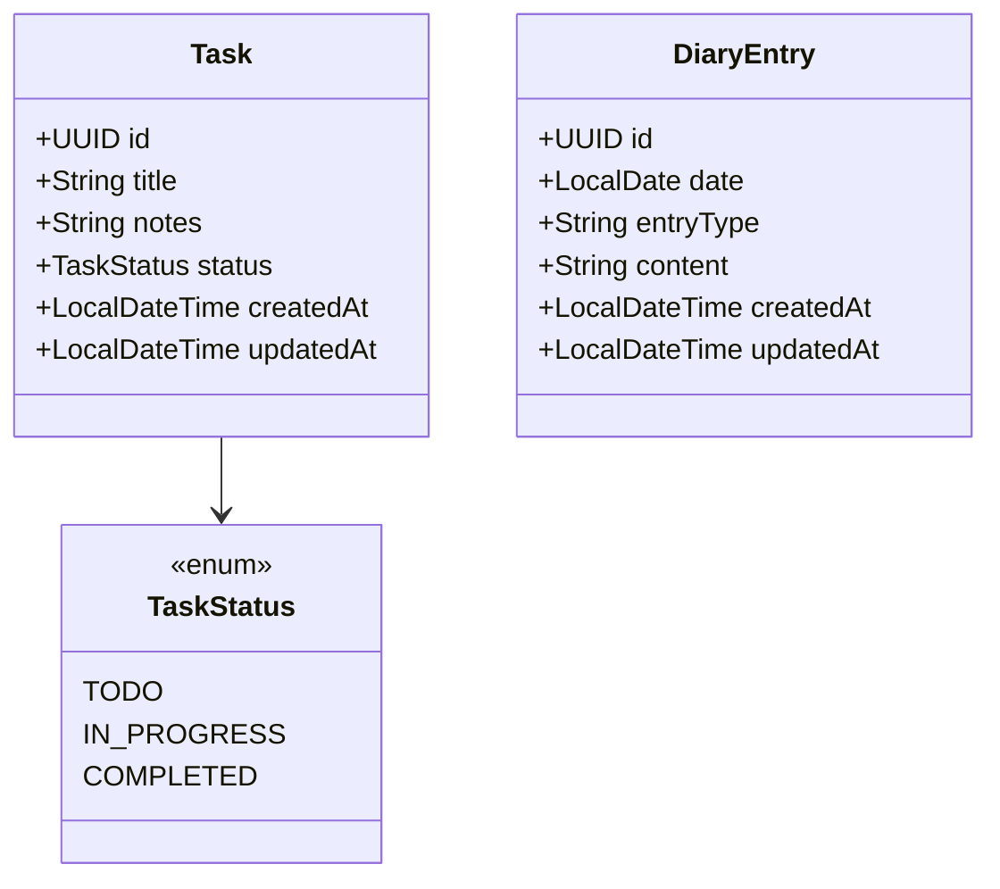

# Architecture Spine — Simple ToDo and Daily Diary

## Design Paradigm

Use a layered architecture with a thin ports-and-adapters boundary: the React UI owns presentation and local interaction state; the Spring Boot API owns validation, business rules, and persistence orchestration; PostgreSQL is the system of record. Run all three locally in v1.



## Invariants & Rules

### AD-1 — UI and backend are separate REST-connected units [ADOPTED]

- **Binds:** all; frontend, backend, config, runtime contracts
- **Prevents:** frontend code importing backend internals, hidden API coupling, or a monolithic app with mixed responsibilities
- **Rule:** The UI may call the backend only through the REST contract; the backend owns validation, task and diary rules, and persistence orchestration. Direct database access from the frontend is forbidden. Client state is presentation/interaction state only: no persisted browser cache or offline mode, and only API-confirmed results are shown as saved; unsaved form text may remain in the active view for retry.

### AD-2 — Task status values and labels are fixed [ADOPTED]

- **Binds:** task domain, UI labels, state transitions, history logic
- **Prevents:** drift among the three task-progress states; accidental extra or alternate states
- **Rule:** The OpenAPI `Task.status` enum is canonical. The UI maps each enum value one-to-one to the corresponding label in `EXPERIENCE.md`; it never persists display labels, invents aliases, or adds states.

### AD-3 — Dashboard recency drives the seven-item rule [ADOPTED]

- **Binds:** task dashboard, task history, task ordering, backend query semantics
- **Prevents:** incompatible “top tasks” definitions across the UI and API; hidden dashboard rules in one layer only
- **Rule:** Dashboard membership is derived at read time from all non-deleted tasks; do not persist a separate dashboard/history flag or membership table. The backend is authoritative and orders by `updatedAt` descending, then UUID ascending. It returns at most seven dashboard tasks across all statuses; all others are History. Every successful task update, status change, and restore refreshes `updatedAt`. After a mutation and whenever a page becomes active, the UI refreshes from the server and does not independently choose the seven items.

### AD-4 — History tasks are view-only until restored [ADOPTED]

- **Binds:** task history dialog, dashboard restore flow, background state transitions
- **Prevents:** out-of-sync task state after a restore or a hidden mutation path bypassing the dashboard rules
- **Rule:** Dashboard tasks may be edited, status-changed, or deleted; History tasks are read-only except for Return to dashboard. Mutation eligibility is checked against the current query-derived seven-task split. Restoring refreshes recency and recalculates selection; failed deletion keeps the task visible and reports failure.

### AD-5 — Diary identity follows the client local calendar date [ADOPTED]

- **Binds:** diary entity, API endpoints, calendar logic, tests, browser local time behavior
- **Prevents:** server clock drift, timezone mismatches, duplicate entries per date, or implicit future/past ambiguity
- **Rule:** Resolve the browser's current IANA timezone before every diary request and send it in the required `X-Client-Time-Zone` header for writes and history. The API is authoritative: it computes today's date and the history window in that exact zone, never server-local time. Missing or invalid zones return `400 INVALID_TIME_ZONE`. Recheck the local date and timezone on page focus/visibility and at local midnight; when either changes, refresh diary eligibility and history before presenting them as current.

### AD-6 — Diary writes are explicit and lock after date rollover [ADOPTED]

- **Binds:** diary write window, validation, past-entry read-only contract
- **Prevents:** editing or creating past/future entries after the date is no longer valid
- **Rule:** The user explicitly saves non-empty content with entry type `FULL_ENTRY` or `SUMMARY`. An entry may be created or updated only on its matching current local date; same-day saves update that entry, future dates are rejected, and past entries are read-only and non-deletable.

### AD-7 — Diary history is exactly four prior local dates [ADOPTED]

- **Binds:** diary history query, UI date navigation, backend retrieval logic
- **Prevents:** history screens that drift from the four-calendar-day rule or incorrectly include today
- **Rule:** History returns exactly the four local calendar dates immediately before today, oldest first, including dates with no entry as explicit `entry: null`; today is separate.

### AD-8 — Diary content remains user-authored and unchanged [ADOPTED]

- **Binds:** diary text model, UI save flow, backend validation, product boundaries
- **Prevents:** AI-generated or auto-summarized diary entries, hidden content mutation, or feature creep into generation
- **Rule:** The app stores exactly what the user enters; it never invents, rewrites, summarizes, or generates diary content.

### AD-9 — Persistence and local integration use environment configuration [ADOPTED]

- **Binds:** backend config, database connection, CORS, deployment environment
- **Prevents:** hardcoded local URLs, environment drift, and brittle startup configuration
- **Rule:** Configure `VITE_API_BASE_URL`, `SPRING_DATASOURCE_URL`, `SPRING_DATASOURCE_USERNAME`, `SPRING_DATASOURCE_PASSWORD`, and `CORS_ALLOWED_ORIGINS` through the environment. Local CORS allows exactly the configured frontend origin; wildcard origins and hardcoded credentials/URLs are forbidden. Default local ports are 5173 (UI), 8080 (API), and 5432 (database), with environment overrides.

### AD-10 — V1 remains local-only until access control exists [ADOPTED]

- **Binds:** runtime exposure, deployment, privacy, authentication boundary
- **Prevents:** exposing private task and diary data to an untrusted network without an access-control boundary
- **Rule:** Bind the UI, API, and PostgreSQL to loopback only (`127.0.0.1`/`::1`); never bind them to `0.0.0.0` or expose them to a LAN/WAN in v1. Authentication and authorization remain deferred until after the local personal-use trial and are mandatory before any network exposure.

### AD-11 — The UI remains a single-page task-and-diary experience [ADOPTED]

- **Binds:** frontend composition, reading order, task history presentation
- **Prevents:** divergent navigation models or treating task history as a separate destination
- **Rule:** Show Tasks before Diary on one page. Present Task History as a dialog over that page; do not add a separate History route. Dashboard and dialog use one application-level task state and the same API refresh pipeline; the dialog is a view, not an independent task cache.

### AD-12 — HTTP status and Problem Details govern API recovery [ADOPTED]

- **Binds:** API validation, mutation results, UI feedback, retry behavior
- **Prevents:** one client treating a failed/conflicting operation as success while another preserves the prior state
- **Rule:** Successful responses return the resource/collection directly as JSON; successful task deletion returns `204 No Content`. Client-visible failures use RFC 9457 Problem Details (`application/problem+json`) with documented `code` and validation `details` extensions. Only successful responses update persisted UI state; failures keep the last confirmed state and preserve entered text where possible. V1 has no entity versions or ETag preconditions: the latest committed mutation is authoritative (last-write-wins), so a stale full task replacement or diary save can overwrite newer fields/content. Refresh from the API after every mutation and whenever a tab becomes active. Handle task-history conflicts, current-date diary conflicts, and invalid-timezone errors according to their documented codes.

### AD-13 — Domain rules do not depend on frameworks [ADOPTED]

- **Binds:** backend domain and application logic
- **Prevents:** framework, database, or transport details becoming the owner of task and diary rules
- **Rule:** Keep domain rules framework-independent. The Spring Boot boundary translates HTTP DTOs into application/domain inputs; services enforce rules; repositories and JPA entities remain behind persistence interfaces.

### AD-14 — Frontend code is feature/domain modular and strictly typed [ADOPTED]

- **Binds:** React modules, API client, shared UI, design system
- **Prevents:** a frontend monolith, unsafe response handling, and duplicated feature behavior
- **Rule:** Organize UI by feature/domain (Tasks, Diary, shared UI) rather than dumping logic into global folders. Use strict TypeScript with explicit immutable request, response, and domain types; do not use `any`. `openapi.yaml` is the wire-contract source of truth: each typed API-client operation preserves its documented response shape rather than assuming one shared payload wrapper. All asynchronous API lifecycles go through feature hooks or a shared typed API client. Separate data/logic containers from presentational components. Use semantic HTML, Tailwind utilities, shadcn/ui component wrappers built on Radix primitives where needed, and tokens from `DESIGN.md`. Design and verify the implemented experience against WCAG 2.2 Level AA; component libraries are aids, not a conformance guarantee. Render errors are contained by React error boundaries, while asynchronous failures are handled explicitly by the API hooks.

### AD-15 — Backend transport, domain, and persistence models stay separate [ADOPTED]

- **Binds:** REST controllers, application services, repositories, JPA entities
- **Prevents:** leaked persistence entities, field-injected dependencies, and business rules hidden in controllers or repositories
- **Rule:** Keep controller → service → repository responsibilities distinct. Controllers accept and return validated DTOs; map explicitly between DTOs, domain values, and JPA entities; never serialize database entities directly. Use constructor injection exclusively. Put transaction boundaries on service operations with `@Transactional`; apply Bean Validation constraints at request boundaries and enforce domain rules in services. Use JPA fetch/query patterns that avoid N+1 access; add pagination for collections only when requirements or data growth justify it.

### AD-16 — Feature changes are test-first and prove their boundaries [ADOPTED]

- **Binds:** frontend and backend feature work, bug fixes, regression handling
- **Prevents:** untested boundaries, regressions, and implementation being treated as complete without evidence
- **Rule:** For each feature module, write/update tests before or alongside implementation for normal, boundary, and error behavior. Use React Testing Library for UI behavior, Mockito for isolated Spring service tests, controller/API tests for contract behavior, and PostgreSQL-backed integration tests for persistence/date/query invariants. Verify WCAG 2.2 AA-relevant behavior with automated checks plus manual keyboard/focus and semantic/assistive-technology review; automated tools alone do not establish conformance. Run relevant tests and project checks before declaring work complete; no blanket code-coverage percentage is implied.

## Engineering Standards

- Keep changes focused and atomic; name work branches `feat/...`, `fix/...`, or `refactor/...` when branch creation is part of the requested workflow. Use conventional semantic commit messages for logical changes; do not create commits unless requested by the user/workflow.
- Follow the formatter, linter, and build conventions established when the project is scaffolded; do not add parallel tooling without a need.
- Plan first: inspect existing schema and frontend/backend paths, then state the implementation approach before editing files. During implementation keep external services behind boundaries; during verification provide tests demonstrating the acceptance behavior.

## Consistency Conventions

| Concern | Convention |
| --- | --- |
| Naming (entities, files, interfaces, events) | Use domain nouns: `Task`, `DiaryEntry`, `TaskStatus`, `TaskHistory`, with REST resources named for the domain rather than UI labels. |
| Data & formats (ids, dates, error shapes, envelopes) | Use stable UUIDs for task identity and local-date strings for diary identity. Return direct resource/collection success payloads; use RFC 9457 Problem Details for errors with documented extensions. |
| State & cross-cutting (mutation, errors, logging, config, auth) | Backend validation and domain rules; environment-sourced config; explicit writes; API-confirmed persistence state; no auth while local-only. |

## Stack

| Name | Version |
| --- | --- |
| React | 19.3.0 |
| Vite | 8.3.4 |
| Node.js | 26.7.0 (user-installed local runtime; Current release) |
| Java | Amazon Corretto OpenJDK 25.0.2.10.1 (LTS build, locally verified) |
| Spring Boot | 4.1.1 |
| Gradle | 9.8.1 |
| Spring Data JPA | managed by Spring Boot 4.1.1 |
| Flyway | managed by Spring Boot 4.1.1; PostgreSQL database module |
| PostgreSQL | 18.6 |

## Structural Seed

### Component architecture

The diagrams below describe the planned v1 architecture; they are implementation guidance, not evidence that the application code already exists.



Only the backend accesses PostgreSQL. UI components call the backend through the configured API client; controllers validate transport data, services enforce domain rules, and repositories persist through JPA. Environment configuration is external to application source. All runtime listeners remain on loopback in v1.

### Local deployment topology



Start the PostgreSQL service and create the `simple_todo` database before starting the API. The API applies versioned Flyway migrations from `backend/src/main/resources/db/migration` and is ready only after migration success; start the Vite frontend after API readiness. The local PostgreSQL service was observed at 18.3; update it to target 18.6 before implementation.

### Spring configuration and database credentials

Spring Boot reads datasource settings from externalized configuration at API startup. The checked-in `application.yml` should name environment-variable placeholders, not contain local passwords:

```yaml
spring:
  datasource:
    url: ${SPRING_DATASOURCE_URL}
    username: ${SPRING_DATASOURCE_USERNAME}
    password: ${SPRING_DATASOURCE_PASSWORD}
server:
  address: ${SERVER_ADDRESS:127.0.0.1}
  port: ${SERVER_PORT:8080}
```

For local development, set those variables in the environment of the terminal or IDE that launches Spring Boot. Spring Boot binds them into datasource configuration and creates the JDBC connection pool; the JPA repositories use that pool to read and write PostgreSQL. Flyway uses the configured datasource to apply migrations during startup. The credentials stay between the backend process and PostgreSQL: they are never sent to React, placed in `VITE_*` variables, or committed to source control. Vite's API base URL is client-visible configuration and must not contain secrets. A local `.env` file is not read automatically by Spring Boot unless additional tooling is deliberately introduced.

### Diary save sequence



If the timezone or content is invalid, or the requested date is not today, the API instead returns a `400` or `409` error and the UI keeps the text unsaved. The backend uses the IANA timezone from each diary request to determine the current local date; it does not use the server's local timezone. A database uniqueness constraint on `DiaryEntry.date` protects the one-entry-per-date invariant.

### Task history restore sequence



If the task is missing, the API returns `404`. If it is already on the dashboard, the API returns `409 TASK_NOT_IN_HISTORY`; the UI keeps its last confirmed view and reports the error.

```text
simple-todo/
  frontend/
    src/
      components/
      hooks/
      services/
  backend/
    src/
      main/
        java/
          com.example.todolist/
            api/
            domain/
            persistence/
            config/
        resources/
          db/
            migration/
      test/
        java/
          com.example.todolist/
```



## Capability → Architecture Map

| Capability / Area | Lives in | Governed by |
| --- | --- | --- |
| Create, edit, status-change, and delete tasks | `frontend/src/components`, `backend/src/main/java/.../api` | AD-1, AD-2, AD-3, AD-4 |
| Dashboard and history selection | `frontend/src/components`, `backend/src/main/java/.../api` | AD-3, AD-4 |
| Diary save and retrieval | `frontend/src/components`, `backend/src/main/java/.../api` | AD-5, AD-6, AD-7 |
| Persistence and query behavior | `backend/src/main/java/.../persistence` | AD-5, AD-9 |
| Validation and config | `backend/src/main/java/.../config`, API layer | AD-1, AD-9 |
| Single-page Tasks/Diary structure and History dialog | `frontend/src/components` | AD-11 |

## Deferred

- Authentication, authorization, accounts, workspaces, and shared ownership: defer until the local personal-use trial is evaluated; required before any network exposure.
- Hosted deployment, external infrastructure/provider selection, and production operations: local-only v1 has no need for them; revisit only if remote access is approved.
- Multi-device sync, collaboration, and server-side audit trails: outside single-user v1; revisit only if the product scope changes.
- AI-assisted diary generation, summaries, and content rewriting: explicitly excluded by the product contract, not planned for v1.
- Node.js 26.7.0 is the installed local runtime and satisfies Vite's engine range; it is not the latest 26.x patch (26.11.1 at verification). Keep it for local use as requested and refresh to a supported patch before any network deployment because Node 26 is Current rather than LTS.
- The installed Amazon Corretto 25.0.2.10.1 runtime is compatible but behind the latest Corretto 25 update (25.0.4.10.1 at verification); refresh to a supported patch before implementation or deployment.
- Database backup/restore UX and automated production operations: defer while the database is a local service; define them before any remote deployment or reliance on the app for non-recoverable records.
